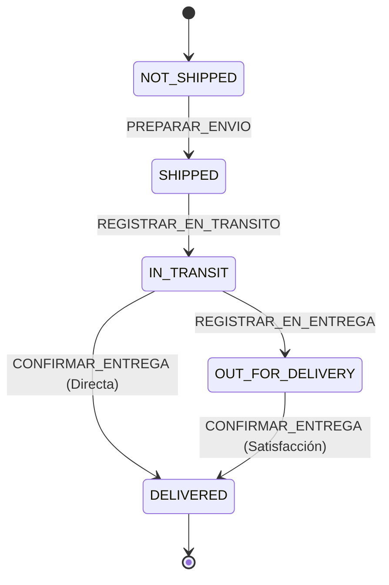

# Arquitectura de Envíos y Rastreo (Shipping & Tracking) - PrintShop Designer

Este documento establece la arquitectura oficial del subsistema logístico de PrintShop Designer, diseñado para desacoplar los despachos físicos del ciclo de vida general de los pedidos y permitir múltiples envíos, eventos inmutables de rastreo y fuentes de verdad unificadas.

---

## 1. Principio Fundamental: Single Source of Truth

> **REGLA DE DOMINIO #1**: `Shipment.shippingStatus` es la **única fuente de verdad** del estado de cada despacho físico.
> `Order.shippingStatus` es un estado derivado/agregado y **nunca** debe almacenarse ni mutarse de forma independiente a sus envíos.

```
┌─────────────────────────────────────────────────────────────┐
│                          Order                              │
│  - orderStatus: OrderStatus                                 │
│  - paymentStatus: PaymentStatus                             │
│  - productionStatus: ProductionStatus                       │
│  - shippingStatus: ShipmentStatus  <─── [DERIVADO/COMPUTADO]│
│  - shipments: Shipment[]                                    │
└──────────────────────────────┬──────────────────────────────┘
                               │
            1:N (Permite despachos parciales)
                               │
                               ▼
┌─────────────────────────────────────────────────────────────┐
│                        Shipment                             │
│  - id: string                                               │
│  - orderId: string                                          │
│  - carrier: string ("Coordinadora", "Servientrega", etc.)   │
│  - trackingNumber: string                                   │
│  - trackingUrl?: string                                     │
│  - shippingStatus: ShipmentStatus [FUENTE DE VERDAD]        │
│  - shippedAt?: string                                       │
│  - estimatedDeliveryAt?: string                             │
│  - deliveredAt?: string                                     │
│  - trackingEvents: TrackingEvent[]                          │
└──────────────────────────────┬──────────────────────────────┘
                               │
            1:N (Historial inmutable de auditoría)
                               │
                               ▼
┌─────────────────────────────────────────────────────────────┐
│                      TrackingEvent                          │
│  - id: string                                               │
│  - shipmentId: string                                       │
│  - status: ShipmentStatus                                   │
│  - description: string                                      │
│  - location?: string                                        │
│  - occurredAt: string                                       │
│  - source: "manual" | "carrier_webhook" | "mock"            │
│  - externalEventId?: string (Idempotencia futura)           │
│  - createdAt: string                                        │
└─────────────────────────────────────────────────────────────┘
```

---

## 2. Estados del Envío (`ShipmentStatus`)

Los estados legales del ciclo de vida de un paquete físico son:

1. **`NOT_SHIPPED`**: No despachado. Pedido en taller o listo para empaque.
2. **`SHIPPED`**: Guía generada y rotulada. Paquete empacado en bodega esperando recolección por parte del camión de la transportadora.
3. **`IN_TRANSIT`**: Recolectado por la transportadora. En movimiento entre bodegas o en transporte intermunicipal.
4. **`OUT_FOR_DELIVERY`**: En ruta de entrega urbana. Cargado en el vehículo de última milla hacia la dirección del cliente.
5. **`DELIVERED`**: Entregado a satisfacción en destino. Certificado con firma o recibo de portería.

### Transiciones Válidas de Estado


### Transiciones Inválidas (Violaciones de Integridad)
- `DELIVERED` ➔ `IN_TRANSIT` (Prohibido revertir paquetes entregados).
- `CANCELLED` ➔ `IN_TRANSIT` (Prohibido despachar pedidos cancelados).
- `NOT_SHIPPED` ➔ `DELIVERED` (Prohibido saltarse el despacho físico).

---

## 3. Algoritmo de Derivación: `getAggregatedShippingStatus`

Cuando una orden contiene 0, 1 o múltiples `Shipments`, el estado logístico a nivel de orden se calcula de acuerdo con la siguiente jerarquía determinista:

```typescript
export function getAggregatedShippingStatus(order: StoreOrderFull): ShipmentStatus {
  const shipments = order.shipments || [];
  if (shipments.length === 0) return "NOT_SHIPPED";

  // Si todos los paquetes han sido entregados con éxito
  if (shipments.every((s) => s.shippingStatus === "DELIVERED")) {
    return "DELIVERED";
  }

  // Si al menos un paquete está en reparto urbano hoy
  if (shipments.some((s) => s.shippingStatus === "OUT_FOR_DELIVERY")) {
    return "OUT_FOR_DELIVERY";
  }

  // Si al menos un paquete se encuentra en tránsito nacional
  if (shipments.some((s) => s.shippingStatus === "IN_TRANSIT")) {
    return "IN_TRANSIT";
  }

  // Si al menos un paquete tiene guía generada esperando recolección
  if (shipments.some((s) => s.shippingStatus === "SHIPPED")) {
    return "SHIPPED";
  }

  return "NOT_SHIPPED";
}
```

---

## 4. Reglas de Disponibilidad de Acciones (3 Estados)

Para garantizar coherencia y evitar que la UI decida arbitrariamente qué botones habilitar o deshabilitar, la función centralizada `getOrderActionAvailability(order)` retorna una lista de `ActionAvailability`:

```typescript
export type ActionAvailability =
  | { status: "AVAILABLE"; action: OrderActionDefinition }
  | { status: "DISABLED"; action: OrderActionDefinition; reason: string }
  | { status: "HIDDEN" };
```

### Matriz de Disponibilidad

| Acción | Condición AVAILABLE | Condición DISABLED (con motivo) | Condición HIDDEN |
|---|---|---|---|
| **`INICIAR_PRODUCCION`** | `productionStatus == NOT_STARTED` y `paymentStatus == PAID` | `paymentStatus != PAID` ("Requiere pago confirmado") | `orderStatus == CANCELLED` o `productionStatus != NOT_STARTED` |
| **`MARCAR_LISTO`** | `productionStatus == IN_PRODUCTION` | `productionStatus == NOT_STARTED` ("Producción aún no iniciada") | `productionStatus == READY` o pedido terminal |
| **`PREPARAR_ENVIO`** | `productionStatus == READY` y no hay envíos pendientes de recolección | `productionStatus != READY` ("Requiere QC aprobado") o ya existe envío en `SHIPPED` | Pedido cancelado o ya `DELIVERED` |
| **`REGISTRAR_EN_TRANSITO`** | Envío activo en estado `SHIPPED` con transportadora y guía | Envío en `SHIPPED` sin guía ("Faltan datos de transportadora o guía") | No existe envío, o ya está en tránsito/entregado |
| **`REGISTRAR_EN_ENTREGA`** | Envío activo en estado `IN_TRANSIT` | Envío en `SHIPPED` ("Debe estar en tránsito antes de reparto") | No existe envío, o ya está entregado |
| **`CONFIRMAR_ENTREGA`** | Envío activo en `OUT_FOR_DELIVERY` o `IN_TRANSIT` | Envío en `SHIPPED` ("Aún no ha sido despachado") | No existe envío, o ya está `DELIVERED` |
| **`CANCELAR_PEDIDO`** | Pedido abierto y `shippingStatus == NOT_SHIPPED` | N/A | Pedido ya despachado (`SHIPPED`, `IN_TRANSIT`, `DELIVERED`) |
| **`REPORTAR_INCIDENCIA`**| Pedido abierto, sin incidencia previa, no entregado | N/A | Incidencia activa, cancelado o entregado |
| **`RASTREAR_GUIA`** | Al menos un envío con número de guía | N/A | Sin guías generadas |

---

## 5. Eventos de Rastreo (`TrackingEvent`)

1. **Inmutabilidad Absoluta**: Los eventos pasados nunca se modifican ni se eliminan. Nuevos estados siempre agregan un nuevo evento al final del arreglo.
2. **Exclusividad por Envío**: Cada `TrackingEvent` pertenece estrictamente a un `shipmentId`. Los eventos de diferentes envíos **nunca se mezclan** en la interfaz ni en la lógica.
3. **Ordenamiento**: Se visualizan y ordenan siempre con base en `occurredAt`.
4. **Origen (`source`)**:
   - `"manual"`: Registrado manualmente por el operario del taller o vendedor.
   - `"carrier_webhook"`: Notificación automática recibida vía webhook o API de la transportadora.
   - `"mock"`: Datos de prueba locales generados para demostración.
5. **Idempotencia**: El campo `externalEventId?` almacena el ID original emitido por la transportadora para prevenir eventos duplicados al recibir reintentos de webhooks.
