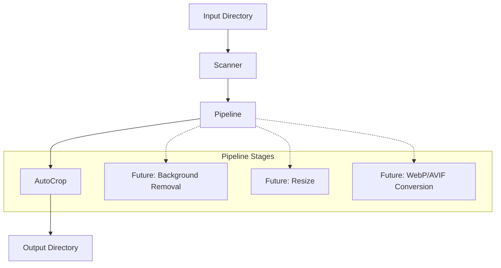

# PrintShop Image Processing Pipeline

An extensible, modular Node.js pipeline designed to automatically detect the useful content area of each image and crop the unnecessary surrounding canvas while preserving the original quality.

**Note:** This module does *not* perform background removal; it strictly crops unnecessary margins based on configurable tolerances.

## Architecture

The pipeline is designed as a series of independent stages. Currently, only the AutoCrop stage is implemented, but the architecture allows for easy extension.



## Project Structure

- `src/config.ts` - Holds the configuration profiles, paths, tolerance values, and margins.
- `src/types.ts` - Contains all core interfaces (BoundingBox, CropOptions, PipelineStage, etc.).
- `src/ImageProcessor.ts` - Utility wrapping `sharp` for low-level image operations and pixel scanning.
- `src/scanner.ts` - Recursively scans the input directory for supported image formats.
- `src/crop.ts` - The AutoCrop pipeline stage.
- `src/pipeline.ts` - The pipeline orchestrator that processes images sequentially through registered stages.
- `src/index.ts` - Main entry point that sets up the pipeline and prints statistics.

## How the Algorithm Works

1. **Scan**: Reads the input directory to find supported images.
2. **Detect Bounding Box**: Iterates over the raw pixels to detect the useful content area by comparing each pixel against the configured `backgroundColor` using a `tolerance` threshold.
3. **Safety Margin**: Adds a configurable safety margin (e.g., 30px) around the detected bounding box, ensuring it never exceeds the image boundaries.
4. **Crop & Save**: Crops the image precisely to the calculated bounding box without any resizing or quality reduction, then saves it to the output directory.

## Configuration

All configuration is located in `src/config.ts`. We use "Processing Profiles" so the pipeline can be adapted for different use cases (e.g., `landing`, `thumbnail`).

### How to change the crop margin
In `src/config.ts`, adjust the `crop.margin` value in your active profile (e.g., `30` for 30px).

### How to change the background threshold
In `src/config.ts`, adjust `crop.backgroundDetection.color` (RGB values) and `crop.backgroundDetection.tolerance` (0-255). A higher tolerance will ignore more color variations as background canvas.

## Extending the Pipeline

To add a new stage (e.g., Watermark):
1. Create a new class implementing the `PipelineStage` interface (from `src/types.ts`).
2. Implement the `execute(inputBuffer: Buffer, context: any): Promise<Buffer>` method.
3. Register the stage in `src/index.ts`:
   ```ts
   pipeline.addStage(new AutoCropStage(profile.crop))
           .addStage(new WatermarkStage());
   ```

## Installation & Execution

1. **Install dependencies:**
   ```bash
   npm install
   ```

2. **Run the pipeline:**
   ```bash
   npm start
   ```
